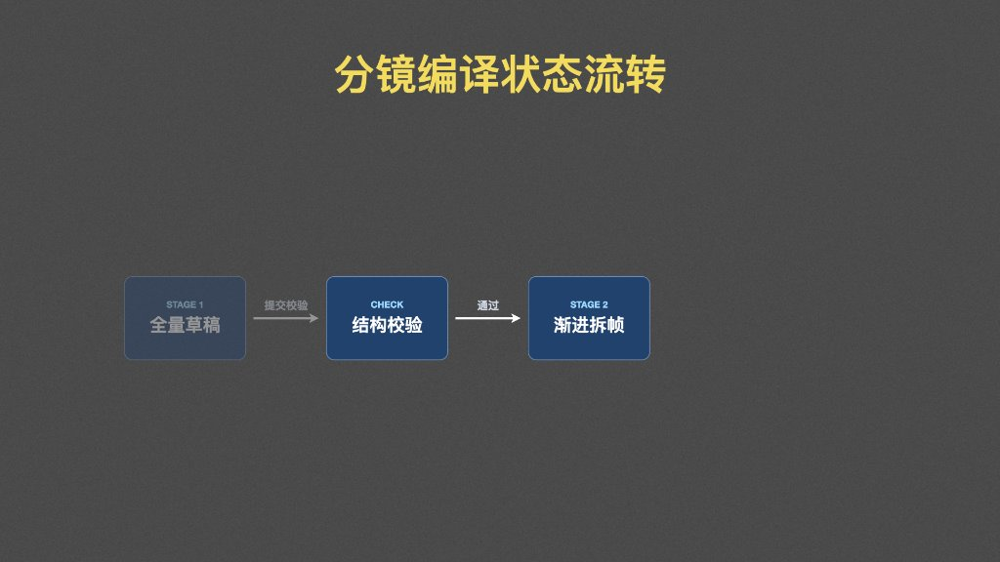
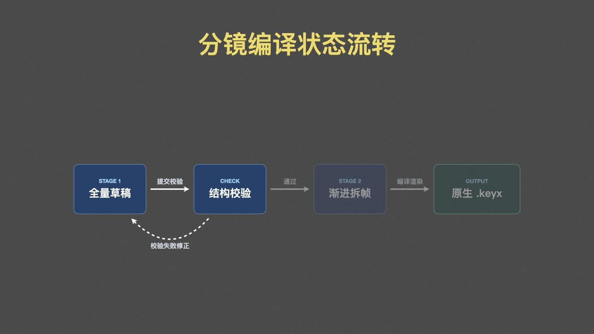
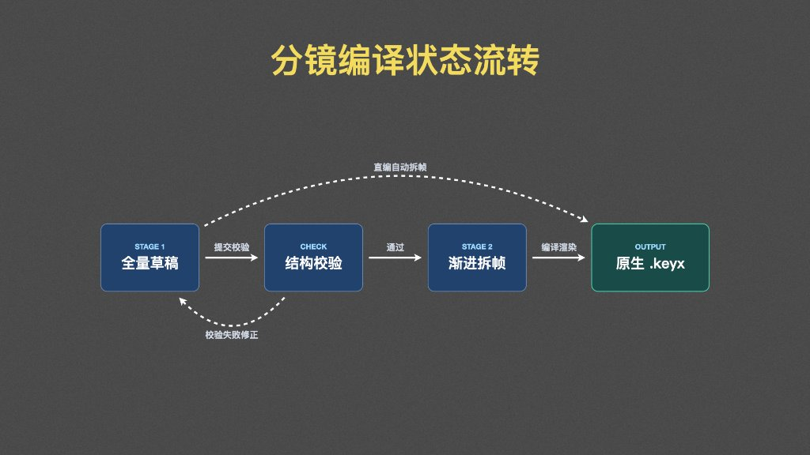

# KeyFlow

English | [简体中文](README.zh-CN.md)

> **Let KeyFlow tell the story behind your writing. KeyFlow turns your text into progressive, cleanly structured Apple Keynote presentations using visual language.**

Most presentation generators simply pack long paragraphs into bullet lists—hard to scan on screen and unhelpful while speaking. **KeyFlow takes the opposite route, letting clear visual structures and step-by-step pacing carry the explanation**:

- **Clean Slide Canvas**: Cards stay to 1–4 short words or key numbers; background explanations, full sentences, and supporting details move into Keynote Presenter Notes.
- **Step-by-Step Reveal Without Layout Shifts**: Nodes and connectors appear progressively across slides, and containers can unpack in place into dashed grids while keeping every existing element locked at the exact same coordinates.
- **Persistent Context Bar**: Multi-section decks can pin a compact overview flow at the top, automatically highlighting the active chapter in orange so the audience never loses the thread when zooming into details.
- **Native `.keyx` Output**: Compiles directly to Apple Keynote's open `.keyx` format without GUI scripting—ready to open, drag, tweak copy, or animate further in Keynote.

---

## Visual Preview

### With Apple Keynote Magic Move

KeyFlow builds every slide on locked coordinates and open-path vector shapes. Open the compiled `.keyx` in Keynote, select all slides, and add the **Magic Move** transition to get step-by-step progressive reveals:

<p align="center">
  
</p>

### Frame-by-Frame Coordinate Lock (`sequence_timeline`)

Notice how every card stays locked in place while concepts, connectors, and curved branches unfold step by step:

<table>
  <tr>
    <td align="center" width="50%">
      
      <br />
      <sub><b>Step 1</b> · Anchor card (<code>STAGE 1</code>) locked at the starting coordinate</sub>
    </td>
    <td align="center" width="50%">
      
      <br />
      <sub><b>Step 2</b> · Main sequence grows right, anchor stays fixed</sub>
    </td>
  </tr>
  <tr>
    <td align="center" width="50%">
      
      <br />
      <sub><b>Step 3</b> · Lower fallback arc spotlighted between check and draft</sub>
    </td>
    <td align="center" width="50%">
      
      <br />
      <sub><b>Step 4</b> · Full state timeline with forward spine and upper skip arc</sub>
    </td>
  </tr>
</table>

---

## Usage

### Option 1: Let Your AI Assistant Handle It (Recommended)

Copy and paste the prompt below to your AI assistant (Antigravity, Codex, Cursor, Harness, etc.) to install and configure KeyFlow automatically:

```text
Please install and configure KeyFlow for me (repository: https://github.com/johhhhnny/keyflow.git):
1. Clone the repository to an appropriate local folder and run `uv sync` to set up the Python environment (install `uv` first if it is not available);
2. Configure the KeyFlow MCP server in your client (stdio command: `uv run --directory <local-KeyFlow-path> keyflow-mcp`);
3. Install the Agent Skill from `<local-KeyFlow-path>/skills/keyflow/`;
4. Run one of the built-in examples afterward to confirm `.keyx` generation works cleanly.
```

KeyFlow ships with an **Agent Skill** ([skills/keyflow/SKILL.md](skills/keyflow/SKILL.md)) and an **MCP server** (`keyflow-mcp`). Once set up, hand any article, analysis report, or Markdown document to your AI assistant to follow the three-stage pipeline (**Stage 0** logical extraction & visual narrative brief → **Stage 1** full-state Scene Graph → **Stage 2** progressive pacing, Tier 1 visual audit, and `.keyx` compilation).

**MCP Client Configuration Example (stdio):**

```json
{
  "mcpServers": {
    "keyflow": {
      "command": "uv",
      "args": ["run", "--directory", "/path/to/KeyFlow", "keyflow-mcp"]
    }
  }
}
```

Available MCP tools:
- `extract_outline`: Extracts a section outline, Mermaid flowcharts, and a draft storyboard from Markdown.
- `pace_storyboard`: Expands a Stage 1 full-state diagram into step-by-step presentation frames.
- `validate_storyboard`: Validates schema structure, node/edge references, and card text-density warnings.
- `audit_storyboard`: Runs deterministic visual self-checks (bounds, overlaps, cross-frame anchor lock across boxes/edges/`pinned_flow`/matrices, scale, overflow) with structured `target_id` and `suggested_action` fix hints.
- `compile_keyx`: Compiles a deck into `.keyx`, returning visual `audit` metrics and optional `review_pngs` paths; supports `fail_on_audit` and `strict` quality gates.
- `preview_keyx`: Exports an existing `.keyx` presentation into per-slide PNG images.
- `list_themes`: Lists built-in visual themes.

### Option 2: Two-Stage CLI Workflow

If you prefer full control over every scene—without manually maintaining dozens of intermediate frame lists—use KeyFlow's two-stage workflow (**design the full diagram first, then pace it automatically**):

1. **Extract a Stage 1 Full-State Structure (`--stage1`)**
   ```bash
   uv run keyflow outline -i path/to/article.md --stage1 -o stage1.json
   ```
   This outputs only the complete target topology per scene, keeping the file short and easy to review or edit. *(Omit `--stage1` if you want a draft with generated `frames` right away.)*

2. **Pace into Progressive Slides (`pace`)**
   ```bash
   uv run keyflow pace -i stage1.json -o storyboard.json --density standard
   ```
   `--density` supports `standard` (gradual step-by-step buildup) and `compact` (tighter pacing). Pass `--overwrite` to re-pace a deck that already has manual `frames`.

3. **Validate, Audit & Compile to `.keyx`**
   ```bash
   uv run keyflow validate -i storyboard.json
   uv run keyflow audit -i storyboard.json --strict
   uv run keyflow compile -i storyboard.json -o out/Presentation.keyx --theme slate_dark --fail-on-audit
   ```
   *(If you do not need custom frame edits, you can also pass `stage1.json` directly into `compile`, which auto-paces any scene without `frames`.)*

**Other Useful Commands:**
- `uv run keyflow themes`: Inspect built-in visual themes.
- `uv run keyflow preview -i out/Presentation.keyx -o out/png`: Export per-slide PNG previews from any existing `.keyx`.

### Requirements

- **Python 3.13+** ([uv](https://docs.astral.sh/uv/) is recommended for automatic Python and dependency management)
- **Apple Keynote** (for opening `.keyx` files, and optionally exporting per-slide PNG previews)

### Run the Built-in Examples

The repository includes 6 example storyboards across varying levels of complexity:

```bash
# Example 1: Minimal 6-frame concept walkthrough (direct Stage 1 compilation)
uv run keyflow compile -i examples/agent_skill_stage1.json -o out/AgentSkill.keyx

# Example 2: LLM sampling deep dive (pinned top flow + Softmax matrix + Top-p proportion bar)
uv run keyflow compile -i examples/llm_sampling_stage1.json -o out/LLM_Sampling.keyx

# Example 3: Freeform compositional canvas (vector progressive chart + native table + progressive inline diagram)
uv run keyflow compile -i examples/freeform_canvas_stage1.json -o out/FreeformCanvas.keyx
```

Add `--preview-dir` on macOS to export per-slide PNG images via Keynote right after compilation:

```bash
uv run keyflow compile -i examples/llm_sampling_stage1.json -o out/LLM_Sampling.keyx --preview-dir out/preview
```

<details>
<summary>View all 6 built-in examples</summary>

- [examples/agent_skill_stage1.json](examples/agent_skill_stage1.json) — ~40-line Stage 1 summary that compiles into a 6-slide progressive walkthrough with zero manual frames.
- [examples/agent_skill_demo.json](examples/agent_skill_demo.json) — Complete 6-frame storyboard with explicit per-frame pacing.
- [examples/keyflow_readme_deck.json](examples/keyflow_readme_deck.json) — Two-scene deck distilled from documentation (overview flow + side-by-side comparison).
- [examples/genres_showcase_stage1.json](examples/genres_showcase_stage1.json) — Showcases `architecture_evolution`, `sequence_timeline`, and `metrics_cards`.
- [examples/llm_sampling_stage1.json](examples/llm_sampling_stage1.json) — Full-featured Stage 1 deck combining `pinned_flow`, `comparison_matrix`, and `proportion_bar`.
- [examples/freeform_canvas_stage1.json](examples/freeform_canvas_stage1.json) — Freeform `canvas` deck combining custom `palette`, pure-`Shape` progressive vector charts, native `Table` & `DonutChart`, and node-by-node inline `diagram` builds.

</details>

---

## Presentation Design Principles

KeyFlow's layouts and pacing rules are built around five practical presentation habits:

1. **Keep the Canvas Sparse; Put Details in Notes**
   Audiences struggle to read dense paragraphs while listening to a speaker. KeyFlow keeps card text to 1–4 words—structural anchors and key figures only—while pushing background context, constraints, and full prose into Keynote Presenter Notes.
2. **Grow Slide by Slide Without Moving Existing Elements**
   Complex workflows should not appear all at once, nor should older boxes jump around on the next click. KeyFlow builds from backbone to branches, or unpacks a node in place into a dashed child grid, while locking every visible element's position across frames.
3. **Keep the Big Picture Visible During Deep Dives**
   When diving into local data, formulas, or edge cases in a long talk, listeners easily lose track of where they are. With `pinned_flow`, the opening slide centers the high-level pipeline, then docks it to the top bar on detail slides with the active stage highlighted in orange.
4. **Match the Visual Form to the Underlying Logic**
   Use topological DAGs for branches, segmented scales for proportions, trend-annotated matrices for multi-variable comparisons, and stacked columns for system evolution. Choosing the right visual structure removes half the verbal explanation.
5. **Designed to Pair Effortlessly with Magic Move**
   Because `.keyx` 1.0 focuses on static document structure without transition metadata, KeyFlow builds every slide specifically for zero-friction Magic Move in Keynote: existing cards stay locked at identical coordinates, `pinned_flow` transitions naturally from center overview to docked header, and one `Cmd + A` → **Magic Move** turns the deck into a fluid animated walkthrough.

---

## Visual Layouts & Customization

### Freeform Compositional Canvas (`layout: "canvas"`, default `use_templates: false`)

When a single preset layout is too rigid for multi-part analytical storytelling, declare `layout: "canvas"` to partition the slide on a 12-column `grid` into non-overlapping `regions` (`stack`, `row`, or `grid`) and compose heterogeneous `.keyx` primitives:

- **7 Object Types**: `card`, `callout`, `textbox`, `shape` (`rounded_rect`, `rect`, `ellipse`, `pill`, or normalized `svg_path`), `chart` (10 chart types, including `waterfall`), `table` (native `.keyx` `Table`), and inline `diagram` (reusing flow/DAG/hub solvers with node-by-node progressive pacing).
- **Dual-Path Charts (`render_mode`: `auto` | `vector` | `native`)**: Under `auto` (default), static `reveal: "whole"` standard charts compile as editable native Keynote `Chart` objects, while progressive `by_series` / `by_category` charts and `waterfall` charts compile as pure `Shape` + `Textbox` vectors with pre-reserved series slots—keeping earlier bar widths and coordinates 100% locked for Apple Keynote **Magic Move**.
- **Template Switch (`use_templates`) & Story Model**: Defaults to `false` (enabling `canvas`, custom `palette` tokens with automatic light/dark text contrast, and optional `story_model` evidence/scope-purity auditing); pass `--use-templates` on the CLI or `use_templates: true` in JSON to enforce the 10 preset layouts only.

### 10 Built-in Layouts (`layout`)

Declare a `layout` per scene and KeyFlow handles all coordinates, spacing, arrow routing, and label collision avoidance:

| Content Pattern | Recommended `layout` | Visual Structure & Pacing Behavior |
|---|---|---|
| Core pipeline, linear steps, lifecycle | `horizontal_flow` | Left-to-right reveal; supports in-place dashed box unpacking (2 items in a row, 3–4 items in a **2×2 grid**) |
| Layered structure, stage stack, call chain | `vertical_flow` | Top-to-bottom progression for hierarchical layers |
| Branching paths, parallel lanes, fork-join merges | `flow_dag` | Layered topological layout with edge labels and optional 2×2 parallel subgrids |
| Version upgrades, migrations, multi-era comparisons | `architecture_evolution` | Stacked architecture columns evolving left-to-right with `LEGACY`/`CURRENT` badges |
| State transitions, stage jumps, retries & fallbacks | `sequence_timeline` | Horizontal spine; forward skips arc above and backward retries/loops arc below |
| Key metrics, benchmarks, headline takeaways | `metrics_cards` | Large `metric` hero figures with subtitles (1–4 in a single row, 5–6 in a 3×2 grid) |
| Distributions, time/cost/resource breakdowns | `proportion_bar` | Color-coded segmented scale (default 0–100, customizable) with staggered callouts and optional left summary list |
| Parameter comparisons, ablations, formula breakdowns | `comparison_matrix` | Centered formula/thesis banner over dashed comparison tables with `↑`/`↓` trend arrows, action bars, and takeaway pills |
| Option A vs Option B, pros/cons contrast | `comparison` | Symmetric left/right columns separated by an automatically revealed dashed `VS` divider |
| Central coordinator with surrounding participants | `hub_spoke` | Anchors the center node first, then connects outer spokes one by one |

### Themes, Card Elements & Global Flow Ribbon

- **3 Textured 1920×1080 Themes** (via top-level `"theme"` or `--theme`):
  - `slate_dark` *(default)*: Matte charcoal-slate background with warm yellow titles and deep blue cards/dashed containers.
  - `midnight_indigo`: Midnight blue texture with amber headings and indigo cards.
  - `paper_light`: Warm off-white paper texture with crisp high-contrast blue cards for print or bright rooms.
- **Composable Card Elements**:
  Beyond the main `label`, cards accept an eyebrow `badge`, hero `metric`, secondary `sublabel`, and semantic `variant` (`primary`, `accent`, `success`, `warn`, `muted`).
- **Deck-Level Persistent Ribbon (`pinned_flow`)**:
  Define top-level pipeline nodes and dashed legend `groups`; bind each scene via `active_flow_node` so the docked header automatically highlights the current chapter in orange.

### Storyboard Authoring Tips

1. **Keep labels short**: Aim for 1–4 words per card; never put full sentences or bulleted lists inside shapes.
2. **Use `note` / `notes` generously**: Put nuances, evidence, and full narrative text in node/frame notes so they appear cleanly in Presenter Notes.
3. **Set `"child_layout": "grid"` for 3–4 sub-items**: Compact 2×2 grids read far better than long single-row expansions.
4. **Lock structure first, tune frames last**: Verify overall flow and layout choices via `outline --stage1` before running `pace`; edit `frames` manually only when custom `focus_nodes` emphasis is needed.

---

## Engineering Design

To keep presentations deterministic, reliable, and friendly to AI agents, KeyFlow makes five deliberate architectural choices:

1. **Declarative Compilation Pipeline, Zero GUI Automation**
   Instead of driving Keynote via fragile AppleScript clicks, KeyFlow runs as a pure compiler: Storyboard JSON → deterministic geometry (`layout.py`) → native `.keyx` archive (`compiler.py`, powered by `creator-studio-doc-format`). Building and validation require no Keynote window at all; Keynote is invoked only when exporting PNG previews.
2. **Two-Stage Split: Structure Design vs. Frame Pacing**
   Maintaining both final layout geometry and 10+ intermediate visibility states at once is error-prone for both humans and LLMs. `outline` (Stage 1) focuses strictly on target topology and layouts, while `pace.py` (Stage 2) deterministically derives step-by-step frames from topology order, container unpacking, and pacing density.
3. **Layout-First Geometry, Frame-by-Frame Visibility Projection**
   To eliminate element jitter across consecutive slides, the layout engine computes coordinates and collision-free routing **once** against the complete final scene. Each compiled slide is simply a visibility and emphasis slice of that fixed geometry. Moreover, instead of Keynote's dynamic `ConnectionLine` (which cross-fades unpredictably under Magic Move), `compiler.py` clips exact box-edge endpoints and quadratic Bezier curves into open-path `Shape` objects so lines match across slides just like cards.
4. **Schema Guardrails Let AI Focus on Semantics**
   Both the CLI and `keyflow-mcp` share strict validation via [schemas/deck.schema.json](schemas/deck.schema.json) and density checks (`schema.py`). AI agents decide structure, wording, and layout genre—while deterministic Python code handles pixel coordinates, typography hierarchy, theme palettes, and globally unique object IDs.
5. **Open, Editable Native Output**
   Because the output is a real `.keyx` document rather than flattened images, KeyFlow gives speakers a clean, structured 90%-finished deck they can freely adjust and polish inside Apple Keynote.

---

## Schema, License & Tests

- Repository: [https://github.com/johhhhnny/keyflow](https://github.com/johhhhnny/keyflow)
- Changelog: [CHANGELOG.md](CHANGELOG.md)
- License: [MIT License](LICENSE)
- Storyboard JSON Schema: [schemas/deck.schema.json](schemas/deck.schema.json)
- Run the automated test suite:
  ```bash
  uv run --extra dev pytest -v
  ```

---

## Acknowledgements

KeyFlow's visual storytelling approach and default matte-slate aesthetic (including the docked overview ribbon and zero-shift incremental builds) were deeply inspired by [马克的技术工作坊](https://www.youtube.com/@%E9%A9%AC%E5%85%8B%E7%9A%84%E6%8A%80%E6%9C%AF%E5%B7%A5%E4%BD%9C%E5%9D%8A) and the tutorial [Keynote 動畫製作全流程，以及我對 AI 動畫的一些看法](https://www.youtube.com/watch?v=5M0bwvHcFko).
