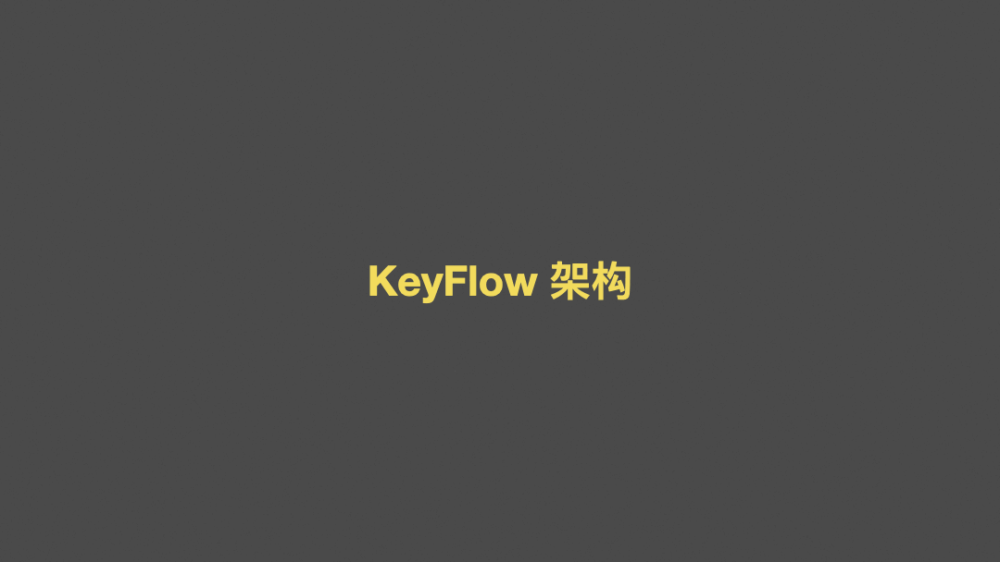
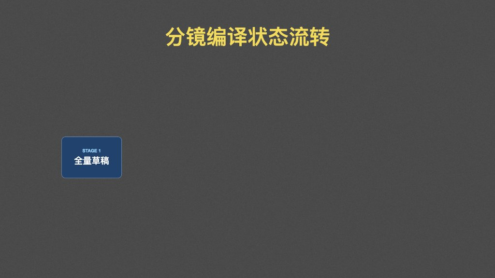
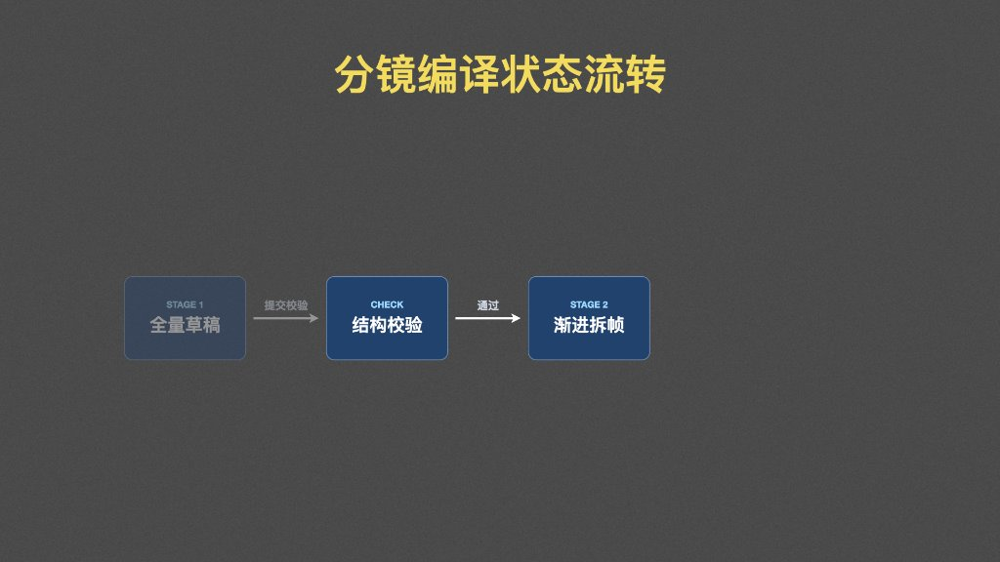
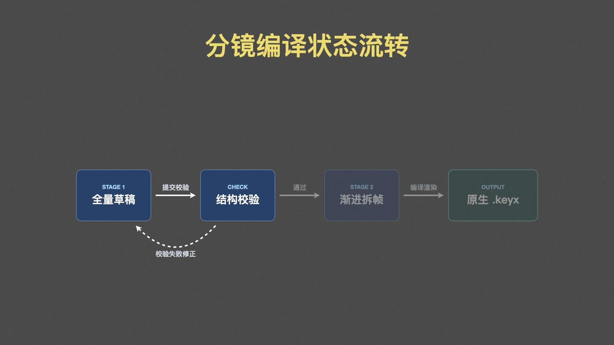
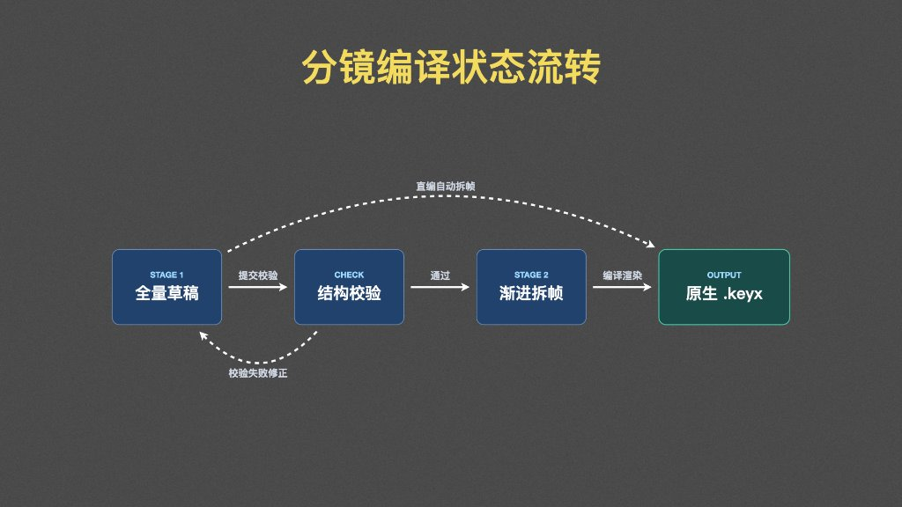

# KeyFlow

[English](README.md) | 简体中文

> **让 KeyFlow 帮你的文字讲故事。KeyFlow 是一个用视觉语言把你的文字变成步步展开的精美 Keynote 的工具。**

大多数演示文稿工具只是把大段大段的文章段落放进项目符号列表，既不便于演讲，也难以突出逻辑重点。**KeyFlow 采用另一种方式——用清晰简洁的视觉结构与逐步展开的节奏来呈现内容**：

- **画布保持简洁**：卡片通常只保留 1–4 个字的关键词，背景说明、完整句子与原文细节全部放进 Keynote 的演讲者备注。
- **步步展开不跳变**：节点和连线随讲解节奏逐页呈现，模块支持原地展开为虚线网格；已出现的元素坐标全程保持固定。
- **全局流程常驻导航**：多章节讲解支持在顶部常驻一条主流程条，自动用橙色高亮当前章节，避免切入细节后丢失上下文。
- **直接生成原生 `.keyx`**：无需通过 GUI 脚本模拟点击拼图，编译产物就是标准 Apple Keynote 文稿，可随时打开调整文案、布局或动画。

---

## 效果预览

### 配合 Keynote「神奇移动」效果

KeyFlow 生成的每页幻灯片都基于同一套锁定坐标与开放路径图形。在 Keynote 中打开 `.keyx` 后，只需全选幻灯片并添加「**神奇移动（Magic Move）**」动画效果，即可直接获得元素步步长出的演示效果：

<p align="center">
  
</p>

### 步进拆帧与坐标锁定（`sequence_timeline`）

下面 4 页来自同一个场景的连续展开——可以看到**已经出现的元素坐标全程锁定**，新节点、连线与正反弧线按节奏一步步长出来：

<table>
  <tr>
    <td align="center" width="50%">
      
      <br />
      <sub><b>Step 1</b> · 起点卡片（<code>全量草稿</code>）先行落位在固定坐标</sub>
    </td>
    <td align="center" width="50%">
      
      <br />
      <sub><b>Step 2</b> · 主轴向右逐步生长（<code>结构校验</code> → <code>渐进拆帧</code>），旧框不动</sub>
    </td>
  </tr>
  <tr>
    <td align="center" width="50%">
      
      <br />
      <sub><b>Step 3</b> · 下方回退弧线（<code>校验失败修正</code>）聚焦高亮</sub>
    </td>
    <td align="center" width="50%">
      
      <br />
      <sub><b>Step 4</b> · 全量图落成（主干链路、下方回退弧与上方跳跃弧线）</sub>
    </td>
  </tr>
</table>

---

## 使用方式

### 方式一：由 AI 助手自动完成（推荐）

只需把下面这段话直接复制发送给你的 AI 助手（Antigravity、Codex、Cursor、Harness 等），让它帮你自动装好环境和工具：

```text
请帮我安装并配置 KeyFlow（仓库地址：https://github.com/johhhhnny/keyflow.git）：
1. 将仓库克隆到本地合适目录，并使用 `uv sync` 初始化运行环境（如果本机还没有 `uv`，请先帮我安装）；
2. 为你当前客户端配置好 KeyFlow 的 MCP 服务（stdio 命令：`uv run --directory <本地KeyFlow路径> keyflow-mcp`）；
3. 安装本项目的 Agent Skill（位于 `<本地KeyFlow路径>/skills/keyflow/`）；
4. 完成后顺便运行一次内置示例，确认能够正常生成 `.keyx` 文件。
```

KeyFlow 自带 **Agent Skill**（[skills/keyflow/SKILL.md](skills/keyflow/SKILL.md)）与 **MCP 服务**（`keyflow-mcp`）。装好之后，只需将长文、分析报告或任何 Markdown 文档交给 AI 助手，即可自动完成结构提取、自动拆帧、`.keyx` 编译与预览导出。

**MCP 客户端配置示例（stdio）：**

```json
{
  "mcpServers": {
    "keyflow": {
      "command": "uv",
      "args": ["run", "--directory", "/path/to/KeyFlow", "keyflow-mcp"]
    }
  }
}
```

提供的 MCP 工具包括：
- `extract_outline`：从 Markdown 文档中提取结构大纲、Mermaid 流程图与分镜初稿
- `pace_storyboard`：将 Stage 1 完整结构图自动拆解为逐页讲解的分镜序列
- `validate_storyboard`：校验分镜结构与节点引用，并检查卡片文字密度是否过高
- `audit_storyboard`：运行视觉自检（越界、碰撞、跨帧坐标锁定、缩紧/溢出风险）并输出结构化修改建议
- `compile_keyx`：编译生成 `.keyx` 文稿，并在返回中附带视觉自检摘要与重点 `review_pngs` 抽检清单
- `preview_keyx`：将已生成的 `.keyx` 导出为逐页 PNG 图片
- `list_themes`：列出可用的内置视觉主题

### 方式二：两阶段命令行工作流

如果你希望亲自把控全局，掌握每个环节，甚至不畏惧手写繁琐的逐帧状态，可以采用“先定完整结构，再自动拆帧”的两步工作流：

1. **提取 Stage 1 全量结构（`--stage1`）**
   ```bash
   uv run keyflow outline -i path/to/article.md --stage1 -o stage1.json
   ```
   这一步只产出每个场景的完整逻辑结构，文件内容精简、便于人工修改。（若无需手工调整，也可省略 `--stage1` 直接输出拆好帧的草稿）

2. **自动拆解演示节奏（`pace`）**
   ```bash
   uv run keyflow pace -i stage1.json -o storyboard.json --density standard
   ```
   `--density` 支持 `standard`（逐步展开）与 `compact`（紧凑节奏）；若需按规则重新拆分已有手写帧的剧本，可加上 `--overwrite`。

3. **校验、视觉自检并编译为 `.keyx`**
   ```bash
   uv run keyflow validate -i storyboard.json
   uv run keyflow audit -i storyboard.json
   uv run keyflow compile -i storyboard.json -o out/Presentation.keyx --theme slate_dark
   ```
   *(若无需人工干预拆帧结果，也可以把第 1 步修改好的 `stage1.json` 直接传给 `compile`，编译前会自动完成拆帧)*

**其他常用命令：**
- `uv run keyflow themes`：查看内置视觉主题说明
- `uv run keyflow preview -i out/Presentation.keyx -o out/png`：单独为已有 `.keyx` 导出 PNG 预览

### 环境要求

- **Python 3.13+**（推荐使用 [uv](https://docs.astral.sh/uv/) 自动管理运行环境与依赖）
- **Apple Keynote**（用于打开生成的 `.keyx` 文稿；也可用于一键导出每页 PNG 预览图）

### 运行内置示例

仓库内置了 6 份不同复杂度的示例剧本，可直接编译查看成片效果：

```bash
# 示例 1：极简 6 页概念讲解（Stage 1 全量图直编）
uv run keyflow compile -i examples/agent_skill_stage1.json -o out/AgentSkill.keyx

# 示例 2：大模型采样原理（顶部常驻导航 + 参数对照表 + 分段比例数轴）
uv run keyflow compile -i examples/llm_sampling_stage1.json -o out/LLM_Sampling.keyx

# 示例 3：自由组合画布（渐进矢量柱状图 + 原生表格 + 逐节点内嵌流程图）
uv run keyflow compile -i examples/freeform_canvas_stage1.json -o out/FreeformCanvas.keyx
```

加上 `--preview-dir`，可在编译的同时调用 Keynote 自动导出逐页 PNG 预览图：

```bash
uv run keyflow compile -i examples/llm_sampling_stage1.json -o out/LLM_Sampling.keyx --preview-dir out/preview
```

<details>
<summary>查看全部 6 份内置示例说明</summary>

- [examples/agent_skill_stage1.json](examples/agent_skill_stage1.json) — 约 40 行的 Stage 1 精简结构，无需手写分页即可生成 6 页渐进演讲稿
- [examples/agent_skill_demo.json](examples/agent_skill_demo.json) — 包含完整逐帧定义的 6 帧标准分镜示例
- [examples/keyflow_readme_deck.json](examples/keyflow_readme_deck.json) — 从文章提炼的双场景分镜示例（结构总览与双侧对比）
- [examples/genres_showcase_stage1.json](examples/genres_showcase_stage1.json) — 展示架构演进、状态弧线流转与关键指标卡片三种版式
- [examples/llm_sampling_stage1.json](examples/llm_sampling_stage1.json) — 较复杂的技术原理讲解示例，包含 `pinned_flow`、`comparison_matrix` 与 `proportion_bar`
- [examples/freeform_canvas_stage1.json](examples/freeform_canvas_stage1.json) — 自由画布综合示例，包含自定义 `palette`、纯矢量渐进柱状图、原生表格与环图，以及逐节点展开的内嵌流程图

</details>

---

## 演示设计原则

KeyFlow 的版式与分页规则围绕以下几个实际体验问题而定：

1. **画面做减法，详细解释放进备注**
   观众很难一边阅读大段文字一边听演讲。因此 KeyFlow 将卡片正文控制在 1–4 个词以内，只保留结构与数字锚点；完整的背景阐述、约束条件与具体细节全部写入 Keynote 的演讲者备注，兼顾台前演示与会后阅读。
2. **逐页增量展开，旧元素位置不变**
   复杂的脉络或流程不应一上来就全盘呈现，也不该在翻页时让已有元素突然位移。KeyFlow 先展示核心骨架，再逐项生长分支，或将单个模块原地展开为虚线框子组；整组讲解过程中所有已出现卡片的坐标始终锁定。
3. **深入细节时保留全局主线**
   长篇内容讲到局部数据、公式推导或细分环节时，听众容易失去方向感。通过全局 `pinned_flow`，开场页可居中展示全链路概览，进入具体章节后流程条自动收拢到屏幕顶部，并将当前章节自动高亮为橙色。
4. **按信息逻辑匹配专门版式**
   因果与分支使用拓扑流程图，占比与构成使用比例数轴，多组数值对比使用带趋势符的对照表，前后演变使用叠层演进图。选对图形载体本身就能省去大量口头铺垫。
5. **天生契合 Keynote 神奇移动（Magic Move）**
   虽然 `.keyx` 1.0 格式暂不包含过场动画字段，KeyFlow 从构图机制上刻意为神奇移动铺好了路：同元素跨页保持坐标与文案严格一致，`pinned_flow` 自然衔接开场居中与置顶缩拢；在 Keynote 中打开后全选（`Cmd + A`）启用神奇移动，即可零成本把静态分镜变成连贯动画。

---

## 视觉体裁与定制

### 自由组合画布（`layout: "canvas"`，默认 `use_templates: false`）

当单一预设版式难以同时承载结论卡片、多维图表、表格与流程拆解时，可为场景声明 `layout: "canvas"`，基于 12 栏 `grid` 划分互不重叠的 `regions`（支持 `stack`、`row`、`grid` 排列），自由组合原生 `.keyx` 视觉对象：

- **7 类自由对象**：`card`（信息卡片）、`callout`（强调结论）、`textbox`（自由文本）、`shape`（几何与自定义 `svg_path`）、`chart`（9 种数据图表）、`table`（原生 `.keyx` 表格），以及支持逐节点展开的内嵌 `diagram`。
- **图表双路径编译（`render_mode`: `auto` | `vector` | `native`）**：默认 `auto` 下，静态全量图（`reveal: "whole"`）编译为可编辑原生 Keynote `Chart`；需要逐步呈现（`by_series` / `by_category`）的图表编译为纯 `Shape` + `Textbox` 矢量组合并预先锁死各系列槽位宽度，确保 Keynote「神奇移动」跨页精准追踪，已有柱体绝不变窄或跳变。
- **模板开关（`use_templates`）**：默认关闭（`false`）以开放自由画布与自定义 `palette`；若需严格限定只用以下 10 种内置版式，可在 JSON 中设置 `use_templates: true` 或在命令行传入 `--use-templates`。

### 10 种内置版式（`layout`）

在每个场景中指定 `layout` 后，卡片坐标、间距、箭头路径与标签避让均由工具自动计算：

| 适用内容 | 推荐版式 (`layout`) | 呈现形式与渐进方式 |
|---|---|---|
| 主干流程、执行步骤、生命周期 | `horizontal_flow` | 从左到右依次出现；支持模块原地展开为虚线容器（2 项横排，3–4 项排为 **2×2 网格**） |
| 上下分层结构、阶段递进、调用链路 | `vertical_flow` | 垂直链路逐层展开，适合表达层级关系与拆解路径 |
| 带分支判断、并行处理与汇总的流程 | `flow_dag` | 按拓扑层级展开分支（支持连线文字标注），分支节点内同样支持 2×2 网格展开 |
| 新旧阶段改造、体系迁移、迭代对比 | `architecture_evolution` | 多代结构叠层容器横向演进，附带 `LEGACY`/`CURRENT` 眉标与演进箭头 |
| 状态流转、阶段跃迁、回退与循环 | `sequence_timeline` | 主轴状态逐步推进；跨步跳转走上方弧线，重试或回退走下方弧线，支持聚光高亮 |
| 关键数据、核心收益、阶段结论 | `metrics_cards` | 突出大字号数字指标与副标说明（1–4 张单行居中，5–6 张自动排为 3×2 网格） |
| 比例构成、分布拆解、资源或时间配比 | `proportion_bar` | 彩色分段比例数轴（默认 0–100，可自定义区间）配合向上虚线标注与可选左侧汇总列表 |
| 多组数值对比、条件消融、公式变化 | `comparison_matrix` | 居中公式或核心结论横幅配合多列虚线数值对照表，支持升降趋势箭头、动作条与结论徽标 |
| 方案对比、正反分析、双方对照 | `comparison` | 左右对称排布，第二侧出现时自动点亮居中的 `VS` 虚线分隔 |
| 中心主轴与多角色协同关系 | `hub_spoke` | 先呈现中心核心节点，再将外围要素逐一连入中心 |

### 主题配色、卡片元素与全局导航

- **3 套 1920×1080 纹理主题**（通过顶层 `"theme"` 或 `--theme` 参数切换）：
  - `slate_dark`（默认）：深灰炭黑磨砂底 + 暖黄标题 + 深蓝卡片与虚线框
  - `midnight_indigo`：深午夜蓝纹理 + 琥珀黄标题 + 靛蓝卡片
  - `paper_light`：浅米白纸质底 + 深蓝高对比卡片（适合打印或明亮环境投影）
- **卡片可组合元素**：
  除主标签 `label` 外，卡片还支持顶部小号眉标 `badge`、大字指标 `metric`、底部副标题 `sublabel`，以及五种语义样式 `variant`（`primary` / `accent` / `success` / `warn` / `muted`）。
- **Deck 级常驻导航（`pinned_flow`）**：
  在顶层配置主链路节点及 `groups` 分组虚线框；开场时居中展示，各详细章节通过 `active_flow_node` 关联后，导航条自动置顶并高亮对应节点。

### 分镜编写建议

1. **精简卡片文字**：主标题尽量控制在 1–4 个词或 12 个汉字以内，避免在卡片中放置整句正文或项目符号列表。
2. **善用备注字段（`note` / `notes`）**：将背景细节、补充依据和完整论述放入节点或帧的备注中，统一沉淀到演讲者备注区。
3. **3–4 项子模块启用 `grid`**：为需要拆箱展开的容器设置 `"child_layout": "grid"`，用紧凑的 2×2 网格代替过长的单行排列。
4. **先确认全局，再局部微调**：先通过 `outline --stage1` 核对主干逻辑与版式选择，再运行 `pace`；仅在需要特定高亮聚焦（`focus_nodes`）时再手工调整 `frames`。

---

## 工程实现思路

为了让这套视觉呈现方式稳定可靠，也便于直接交给 AI Agent 驱动，KeyFlow 在架构上做了以下取舍：

1. **声明式编译管线，不依赖 GUI 自动化**
   项目没有采用 AppleScript 或 UI 自动化去操控 Keynote 客户端，而是将整个流程实现为一个纯文本编译器：从剧本 JSON 出发，经过 `layout.py` 计算几何布局，再由 `compiler.py` 直接写出原生 `.keyx` 文档（基于 `creator-studio-doc-format`）。正常编译与校验全程无需启动 Keynote，仅在导出 PNG 预览时才调用本机 Keynote。
2. **结构设计与节奏拆帧两阶段解耦**
   无论是人工编写还是 AI 生成，同时维护最终构图与十几页中间可见状态都非常容易出错。因此 `outline`（Stage 1）只负责确定完整结构与版式选择，`pace.py`（Stage 2）再依据拓扑层级、拆箱边界与密度规则确定性地拆出逐帧序列。
3. **先计算全图坐标，再按帧做可见性裁切**
   为了彻底避免翻页时已有元素的位置发生抖动，布局引擎永远只按“全部元素同时出现”的最终状态计算一次坐标与防碰撞路径；`compiler.py` 生成每一页幻灯片时，只是从这份完整几何结果中截取当前帧需要显示的元素与聚焦状态。同时，所有箭头与曲线都避开容易在转场时淡出断开的 `ConnectionLine`，统一裁剪编译为开放路径 `Shape`，使线条在 Keynote 神奇移动中也能与卡片一样稳定跟踪。
4. **用 Schema 约束边界，让 AI 专注内容与结构**
   CLI 与 `keyflow-mcp` 共用同一套校验能力。借助 [schemas/deck.schema.json](schemas/deck.schema.json) 与密度校验（`schema.py`），AI 只需负责总结观点和挑选版式；具体的坐标计算、排版层级、色板搭配与全局唯一 ID 分配全部交给确定性的代码层处理。
5. **输出可编辑的原生产物**
   自动生成很难一步到位满足所有主观审美微调。编译为原生的 `.keyx` 文件而非静态图片，意味着 KeyFlow 交付的是一份结构清晰、在 Keynote 中仍可自由拖拽、改字与追加动画的干净底稿。

---

## 协议与测试

- 项目仓库：[https://github.com/johhhhnny/keyflow](https://github.com/johhhhnny/keyflow)
- 开源协议：[MIT License](LICENSE)
- 完整 JSON 分镜格式定义：[schemas/deck.schema.json](schemas/deck.schema.json)
- 运行自动化测试套件：
  ```bash
  uv run --extra dev pytest -v
  ```

---

## 鸣谢

本项目的视觉叙事灵感以及默认深灰磨砂风格的排版样式深受[马克的技术工作坊](https://www.youtube.com/@%E9%A9%AC%E5%85%8B%E7%9A%84%E6%8A%80%E6%9C%AF%E5%B7%A5%E4%BD%9C%E5%9D%8A) 及其教程[Keynote 動畫製作全流程，以及我對 AI 動畫的一些看法](https://www.youtube.com/watch?v=5M0bwvHcFko) 的启发，特此感谢。
